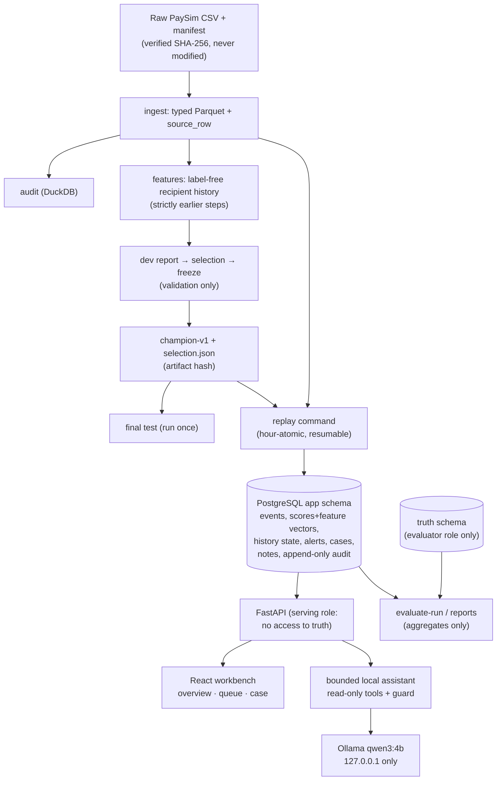

# Architecture

## Boundaries

| boundary | how it is enforced |
|---|---|
| No labels at serving time | `isFraud` lives only in `truth.label`; the `fraudinv_app` role has no privilege on schema `truth` (tested). The API's `/evaluation` serves aggregate report files only. |
| No forbidden inputs | `config/feature_contract.yaml` + `fraudinv.contract` reject forbidden names and lineage. API request models forbid extra fields (labels, balances, aggregates and cutoffs → 422). |
| No future information | History uses step < s, with whole hours scored from previous-hour state. Replay requires history to end at s−1. Case evidence is limited to `case_evidence_cutoff_step`; assistant tools cap `before_step`. |
| Test isolation | `data.load_partition("test")` needs `allow_test=True` and a frozen selection; `final-test` refuses a second run. |
| Recoverable replay | One transaction per hour (events, scores, history, cursor); day-end finalization is idempotent and keyed by (run, partition, day). |
| Human decisions | Bearer-token analysts (hashed), optimistic versions (409 on stale), audit events in the same transaction; audit rows cannot be updated or deleted (trigger). |
| Assistant | Bound to one case; read-only DB session; no write tools; server-assigned evidence refs; a deterministic guard removes unknown refs, unsupported numbers, outcome claims and balance assertions; local inference only. |

## Components

| path | role |
|---|---|
| `src/fraudinv/{source,ingest,audit}.py` | verification, ingest, Day 1 audit |
| `src/fraudinv/{contract,splits,history,features}.py` | frozen contracts and history features |
| `src/fraudinv/{baselines,evaluation,dev_report,model_select,freeze}.py` | evaluation and model selection |
| `src/fraudinv/{db,serving,replay,api,cases}.py` + `sql/` | application state, scoring, replay, workflow API |
| `src/fraudinv/{assistant,assistant_eval}.py` + `eval/` | local assistant and its evaluation |
| `web/` | React/TypeScript workbench (Vite 6) |
| `reports/` | generated, machine-readable evidence for every milestone |
| `docs/checkpoints/` | daily checkpoints with commands, results and limitations |

## Runtime

- One local machine. PostgreSQL 18.4 in Docker on 127.0.0.1:55432, FastAPI and the built UI on 127.0.0.1:8765, Ollama on 127.0.0.1:11434 (only while the assistant is used).
- Python 3.13, Node 22.9. The planned eve agent module was not adopted: `eve@1.0.0-rc.7` requires Node ≥ 24.
